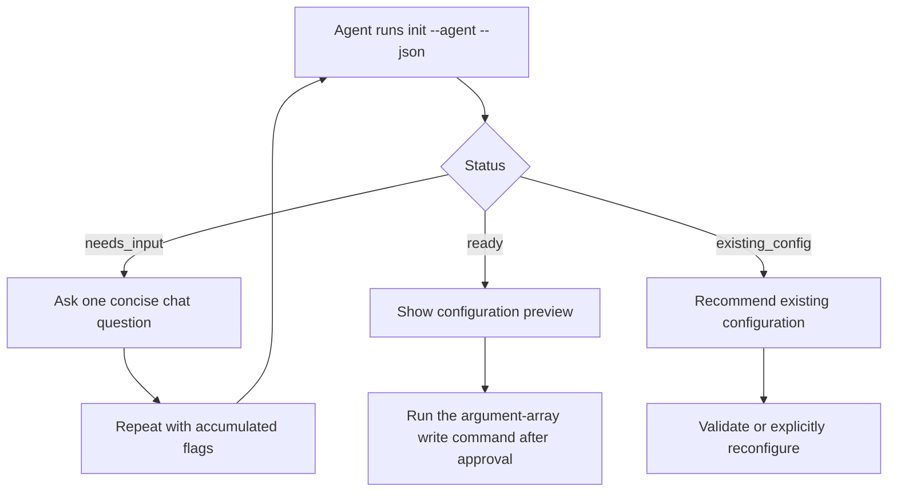

# Technical validation status

Validated on a real Chrome Web Store item with a manually authenticated, dedicated
official Chrome profile and loopback CDP connection.

## Confirmed

- Local ZIP and manifest normalization, permission comparison, listing asset checks,
  deterministic plans, stale-plan guards, and output redaction.
- Read-only package, listing, image, URL, data-use, and privacy declaration reads.
- Full desired-state comparison across package, listing, images, and privacy.
- Icon, screenshot, small promotional tile, and marquee promotional tile
  replacement, draft save, reload, and visual read-back.
- Package ZIP upload from an approved version-bound plan and read-back of the new
  draft package version.
- Single-purpose, permission-justification, and host-permission privacy-copy writes
  from an approved plan, followed by a zero-operation read-back.
- Existing authenticated session use without controlling the user's daily Chrome.
- Automatic navigation from an authenticated Dashboard tab to the exact configured
  item, without requiring the user to find or open the item editor first.
- Agent initialization as a multi-turn JSON protocol: `needs_input` questions for
  artifact, resource root, item ID, language, and endpoint; a `ready` preview with
  an argument-array write command; and `existing_config` detection after writing.

## Agent CLI behavior

Tested in Codex Desktop on 2026-09-22. The CLI returned structured questions and
choices correctly, and the agent completed initialization through ordinary chat
and local command execution. DashBye treats this as a text-based CLI protocol and
does not require a GUI-specific menu or input control.

The environment did not have a global `dashbye` executable. Replacing the executable
in the returned `writeCommand` with the local `node dist/src/cli.js` entry point
succeeded, created the ignored test configuration, and produced `existing_config`
on the next run.

## Failed and fixed

- Waiting for a native `filechooser` event timed out because **Upload new package**
  opens an in-page upload dialog. The adapter now targets that dialog's ZIP/CRX file
  input and verifies the resulting draft version.
- The original 8×8 grayscale average hash treated visually similar old and new store
  artwork as equal. Asset comparison now uses a 16×16 RGB signature with a measured
  thumbnail-encoding tolerance. Regression tests distinguish resizing from material
  artwork changes, and public inspect output exposes only hashes of these signatures.
- The 16×16 mean also treated a redesigned settings screenshot as unchanged: thin
  lines and text averaged away (0.5% difference against a 1.2% tolerance), so the
  plan skipped the screenshot replacement. Screenshots now use a 64×40 grayscale
  signature compared by its worst 8×8 block. On real Dashboard thumbnails
  (160×100 CSS px), re-encoding noise peaked at 0.0155 and the redesign measured at
  least 0.0357; the tolerance is 0.025. Grayscale alone missed a colour-only change
  at similar luminance (`#d03030` vs `#507a50`: 0.0078), so screenshots must also
  match the existing 16×16 RGB signature. Icons and promo tiles keep the 16×16
  comparison, which was not recalibrated. The combined check is unit-tested; the
  real-thumbnail calibration above covered the grayscale part only.
- On 2026-10-12 a read-only check on a second, text-dense item found its three
  unchanged screenshots at 0.027–0.032 worst-block against their local sources
  (cross-pairings ≥ 0.118, colour mean 0.007–0.009) and the icon at 0.0153, so
  `plan` proposed replacing images that had not changed. The Dashboard previews
  are lossy WebP renditions from Google's image service (`w320-h200-rw` for
  screenshots, `s256-rw` for the 128 px icon); the element screenshots copied them.
  Requesting the same images with the `s0` size option returned the stored 1280×800
  PNG screenshots and 128×128 PNG icon, which compared at exactly 0.0000 with the
  local files. The difference was thumbnail noise, not a different upload. The
  Chrome adapter now fetches that stored original through the work tab, without
  cookies, instead of screenshotting the preview, and stops on any image source
  that is not the image service or a local upload preview. With that change,
  `plan` on the same item reported zero operations. Tolerances are unchanged
  (block 0.025, colour 0.012), so the redesign (≥ 0.0357) and colour-only
  (`#d03030` vs `#507a50`) cases remain detected. The check used only navigation,
  image reads, and `plan`; no draft was saved, and no screenshots or image URLs were
  kept.
- The remote-code privacy card was located by the text "Remote code", which also
  matches permission justifications such as "does not execute remote code". Reads
  timed out on the wrong card, and writes could have filled its text area. The card
  is now required to contain the yes/no radios.
- Dashboard image removal opens a confirmation dialog. The adapter now confirms
  each planned removal, waits for the replacement preview to finish loading, and
  requires the Save draft state to remain settled before read-back.
- The Dashboard's current English selector uses the full
  `English – en (default)` label, while the adapter expected `English`. Selection now
  prefers the configured full label and keeps the short label only as a fallback.
- The Dashboard may retain duplicate hidden component trees. Reads and writes now
  target visible controls, and screenshot previews are de-duplicated by their
  rendered position rather than by image content.
- On 2026-10-12, with the item in **Pending review**, `sync-draft` timed out after
  30 s in `locator.fill` because every listing text area was disabled; no draft
  changed. A read-only check of the same item then found the header text
  `Status: Pending review` and every visible text area and text input disabled on
  the Store listing (1 text area, 3 inputs) and Privacy (8 text areas, 1 input)
  pages, with Save draft disabled. The read now records `editLock` (the review
  status and whether each page has a disabled field) as booleans. On the same item,
  `plan` still listed its 3 differences and added the lock as `blocking`, and
  `sync-draft` refused that plan before opening Chrome. On 2026-10-14 the same item
  was published (no review status), and the unlocked path still reported
  `Privacy fields are read-only`: the item declares no remote code, and the
  Dashboard disables that card's justification field (1 of 9 privacy fields). A page
  now counts as locked only when every visible text field on it is disabled. With
  that change, a read-only `plan` reported zero operations and no `blocking`. The
  live-page guard that runs again before the first fill has not been exercised on a
  real Dashboard yet.
- After replacing a small promotional tile, the immediate read-back still differed
  and `sync-draft` failed without a lock; a later zero-operation sync succeeded.
  `sync-draft` now rereads the saved draft a bounded number of times (read-only,
  no write is repeated) before reporting a difference. Unit-tested; the retry has
  not yet been exercised on a real Dashboard.
- Section navigation was made to skip the click when the tab is already on the
  section and to fall back to the section URL when the click does not settle. The
  first version accepted either the section path or the title, and the Dashboard
  updates the URL about 250 ms before it renders the section, so reads ran on the
  previous section and timed out on the Language selector. The root Dashboard title
  also contains "Store". A section now counts as open only when the path ends with
  the section suffix and the title starts with the section name. Checked on
  2026-10-12 with read-only `plan` runs: two consecutive runs matched the previous
  adapter's operations and remote snapshot hash exactly. The fallback builds the
  section URL only from the current edit URL of the configured item on either
  Dashboard host; those runs settled after the click, so the fallback itself did not
  run.

## Not yet validated

- Firefox: the AMO read and preview fingerprinting were checked read-only against a
  public add-on. The validation upload and a plan against an add-on the owner
  controls have not run; they need the owner's AMO API key. Store detection and
  store selection were checked read-only on X-TOC and Bookmark Assistant.
- Edge: no Partner Center automation exists yet; configured Edge targets are
  validated locally and reported as not supported.
- Opening the dedicated Chrome from `plan`, `inspect`, or `sync-draft`, waiting for
  manual sign-in, and the `[Y/n]` confirmation in `sync-draft`. These are unit-tested
  with injected dependencies; `dashbye chrome` was checked against an already
  running dedicated session, and on 2026-10-12 against one with every window closed
  (it opened a Dashboard window and `doctor` then connected). Windows and Linux Chrome locations are untested.
- Fingerprinting images from the stored original during read-back after a real
  image replacement. Only the read path on unchanged images has run; blob: and data:
  upload previews are accepted but have not been observed on a real Dashboard.
- Reusing a manually authenticated profile in a newly launched headless process.
  The supported path remains a visible dedicated Chrome connected over loopback CDP.
- A collected-data change, certification change, or new permission confirmation.
  These remain plan-bound and owner-approved operations.
- Multiple locales and Dashboard languages other than English.
- The section-URL fallback when a section link click does not settle.
- Review submission and publication. They are intentionally outside DashBye.
